Tarjetas SVG animadas generadas por <a href="scripts/render_cards.py">scripts/render_cards.py</a> a partir de <a href="data/contributions.json">data/contributions.json</a>; una acción programada las redibuja cada día.
